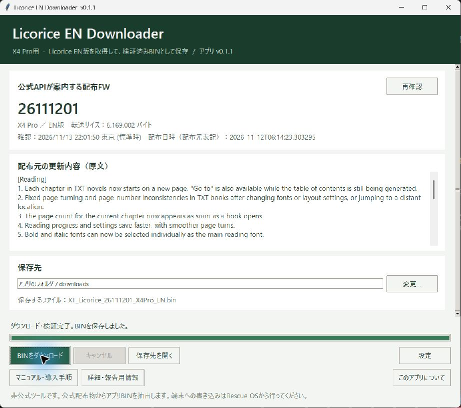

# Licorice EN Downloader

日本語 | [English](README.md)

XTEINK製電子書籍リーダー X4 Pro用のLicorice EN版を公式Global更新APIから取得し、Rescue OSで導入するアプリBINとして保存する、Windows用の非公式ツールです。ソースコードはMITライセンスで公開します。

**現在は開発版 v0.2.0です。** 公式配布物の取得・抽出・検証・保存は確認していますが、出力BINの実機導入・起動・言語選択は未検証です。

## ダウンロード

- [開発版 v0.2.0（Windows x64ポータブルZIP）](https://github.com/miya-bee/licorice-en-downloader/releases/download/v0.2.0/LicoriceENDownloader-v0.2.0-windows-x64-dev.zip)
- [SHA-256](https://github.com/miya-bee/licorice-en-downloader/releases/download/v0.2.0/LicoriceENDownloader-v0.2.0-windows-x64-dev.zip.sha256)
- [配布ページ・リリース情報](https://github.com/miya-bee/licorice-en-downloader/releases)
- [日本語の操作マニュアル](https://miya-bee.github.io/licorice-en-downloader/)

通常の利用では、上のポータブルZIPを取得してください。GitHubの「Code → Download ZIP」はソースコードです。

## 使い方

1. ポータブルZIPを、書き込み可能なフォルダへすべて展開します。
2. `LicoriceENDownloader.exe` を起動します。Pythonの導入は不要です。
3. 配布情報と保存先を確認し、「BINをダウンロード」を押します。
4. 「ダウンロード・検証完了」を確認し、「保存先を開く」を押します。
5. [操作マニュアル](https://miya-bee.github.io/licorice-en-downloader/)で導入方法と確認事項を確認します。



Rescue OSの入手先：[Rescue OS for X4 Pro — 作者Eさんの配布記事](https://note.com/ample_zephyr2723/n/necd67d1bccb3)。記事内のダウンロード欄を確認してください。準備についてはマニュアルの第5章で別に扱います。

画面・マニュアルは日本語と英語に対応しています（画面はWindowsの表示言語に合わせて自動選択し、「設定」から変更できます）。配布元の更新内容は原文で表示します。端末接続・アカウント・実端末IDの入力は必要ありません。FWへのパッチや、端末への直接書き込みは行いません。

## 機能

- X4 ProのLicorice EN版に限定した配布情報の確認。
- XOTAの復号・抽出、サイズ・SHA-256・対象識別情報・ESPイメージの検証。
- 検証成功後のBIN保存、同名ファイルの上書き確認、キャンセル。
- 任意で元のXOTAと取得情報JSONを追加保存。
- EXEと同じフォルダへの設定保存。アプリフォルダ内の保存先は相対指定。
- 詳細・報告用情報の表示とコピー。
- 日本語・英語の表示切り替え（自動・日本語・English）。

## 開発環境

Python 3.10以降、Tkinter、cryptographyを使用します。Windows x64 / Python 3.10.11 / Tcl/Tk 8.6.12で開発・確認しています。正式な対応Windows範囲は確認中です。

```powershell
git clone https://github.com/miya-bee/licorice-en-downloader.git
cd licorice-en-downloader
python -m venv .venv
.\.venv\Scripts\python.exe -m pip install -r requirements-build.txt
.\.venv\Scripts\python.exe main.py
```

### テスト

```powershell
python -m unittest discover -s tests -v
```

回帰テスト64件を収録しています。ネットワークに接続せず、公式FWをフィクスチャとして同梱することもありません。GUIテストはWindowsの画面環境を使用します。GitHub ActionsでもWindows上で実行します。

### 開発用CLI

```powershell
python -m licorice.cli
python -m licorice.cli --download .dev-validation/live --extras
```

省略時は配布情報の照会のみです。`--download` 指定時は公式配布物を取得して検証・保存します。同名ファイルは `--overwrite` を指定した場合だけ上書きします。

### Windowsポータブル版のビルド

```powershell
python tools/build.py
```

テスト後にPyInstallerでEXE化し、マニュアル・MITライセンス・第三者ライセンス・バグ修正記録を含むZIPと、そのSHA-256を `dist` に作成します。設定・ログ・取得済みFWは同梱しません。Windows x64版Pythonで実行してください。ビルド環境にTcl/Tkのライセンス文書が必要です。Tcl 8.6.12の文書は同じ版の公式ソース由来のものを収録しています。

## 文書

- [仕様書](SPECIFICATION.md)
- [操作マニュアル](docs/index.html)
- [実装・検証状況](IMPLEMENTATION.md)
- [バグ調査・修正記録](BUG_AUDIT.md)
- [第三者表記](THIRD_PARTY_NOTICES.md)
- [MITライセンス](LICENSE)
- [不具合・機能・対応機種の要望](https://github.com/miya-bee/licorice-en-downloader/issues)

不具合報告にはアプリの「詳細・報告用情報」を利用してください。個体バックアップや認証情報の投稿は不要です。XTEINKのFWには本アプリのMITライセンスを適用しません。
