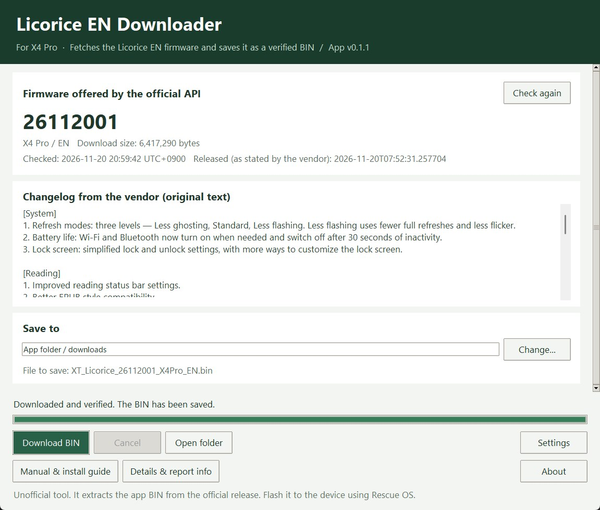

# Licorice EN Downloader

[日本語](README.ja.md) | English

An unofficial Windows tool that fetches the Licorice EN firmware for the XTEINK X4 Pro e-reader from the official Global update API and saves it as the app BIN you install with Rescue OS. The source code is released under the MIT License.

**This is development build v0.2.1.** Fetching, extracting, verifying and saving the official release have been tested. Installing the produced BIN on a real device, booting it and choosing a language have not been tested yet.

## Download

- [Development build v0.2.1 (Windows x64 portable ZIP)](https://github.com/miya-bee/licorice-en-downloader/releases/download/v0.2.1/LicoriceENDownloader-v0.2.1-windows-x64-dev.zip)
- [SHA-256](https://github.com/miya-bee/licorice-en-downloader/releases/download/v0.2.1/LicoriceENDownloader-v0.2.1-windows-x64-dev.zip.sha256)
- [Releases](https://github.com/miya-bee/licorice-en-downloader/releases)
- [Manual (English)](https://miya-bee.github.io/licorice-en-downloader/en/)

For normal use, get the portable ZIP above. GitHub's “Code → Download ZIP” is the source code.

## Usage

1. Extract the whole portable ZIP to a folder you can write to.
2. Run `LicoriceENDownloader.exe`. You don't need to install Python.
3. Check the release info and the destination, then click **Download BIN**.
4. When the status reads **Downloaded and verified**, click **Open folder**.
5. Read the [manual](https://miya-bee.github.io/licorice-en-downloader/en/) for installation notes and what to check.



Where to get Rescue OS: [Rescue OS for X4 Pro, release article by its author “E” (in Japanese)](https://note.com/ample_zephyr2723/n/necd67d1bccb3). See the download section of the article. Chapter 5 of the manual covers preparation separately.

The UI is in English or Japanese, following the Windows display language (switch under **Settings**). The vendor's changelog is shown as published. You don't need to connect the device, sign in, or enter a device ID. The app does not patch the firmware or write to the device.

## Features

- Checks release info, limited to the Licorice EN build for X4 Pro.
- Decrypts and extracts the XOTA, and verifies size, SHA-256, target identifiers and the ESP image.
- Saves the BIN only after verification succeeds, asks before overwriting files with the same name, and supports cancelling.
- Optionally also saves the original XOTA and an info JSON.
- Stores settings next to the EXE. A destination inside the app folder is stored as a relative path.
- Shows and copies details for bug reports.
- English and Japanese UI (Auto, 日本語, English).

## Development

Uses Python 3.10+, Tkinter and cryptography. Developed and tested on Windows x64 / Python 3.10.11 / Tcl/Tk 8.6.12. The officially supported range of Windows versions is still being checked.

```powershell
git clone https://github.com/miya-bee/licorice-en-downloader.git
cd licorice-en-downloader
python -m venv .venv
.\.venv\Scripts\python.exe -m pip install -r requirements-build.txt
.\.venv\Scripts\python.exe main.py
```

### Language

The UI follows the Windows display language: Japanese on Japanese Windows, English otherwise. Change it under **Settings → 表示言語 / Language** (stored in `settings.json`, applied after restart). For the CLI or for testing, the `LICORICE_LANG` environment variable (`ja` or `en`) overrides detection.

UI text lives in [`licorice/i18n.py`](licorice/i18n.py). The Japanese strings in the code are the keys and `EN` holds the English text. `tests/test_i18n.py` checks that every string has an English entry with matching placeholders.

### Tests

```powershell
python -m unittest discover -s tests -v
```

64 regression tests. They make no network connections and don't bundle official firmware as fixtures. GUI tests need a Windows desktop session and run in both Japanese and English. They also run on Windows in GitHub Actions.

### Development CLI

```powershell
python -m licorice.cli
python -m licorice.cli --download .dev-validation/live --extras
```

By default it only checks the release info. With `--download`, it fetches, verifies and saves the official release. Existing files are overwritten only with `--overwrite`.

### Building the Windows portable version

```powershell
python tools/build.py
```

Runs the tests, builds the EXE with PyInstaller, and creates a ZIP in `dist` with the manual, MIT License, third-party licenses and bug-fix record, plus its SHA-256. Settings, logs and downloaded firmware are never included. Run it with Windows x64 Python. The build environment needs the Tcl/Tk license files. The Tcl 8.6.12 license included in the repo comes from the official source of the same version.

## Documents

Detailed design documents are in Japanese.

- [Specification (Japanese)](SPECIFICATION.md)
- [Manual (English)](docs/en/index.html) / [Manual (Japanese)](docs/index.html)
- [Implementation and verification status (Japanese)](IMPLEMENTATION.md)
- [Bug audit and fixes (Japanese)](BUG_AUDIT.md)
- [Third-party notices](THIRD_PARTY_NOTICES.md)
- [MIT License](LICENSE)
- [Bugs, features and device requests](https://github.com/miya-bee/licorice-en-downloader/issues)

When reporting a bug, please use **Details & report info** in the app. Don't post device backups or credentials. The MIT License of this app does not apply to XTEINK's firmware.
